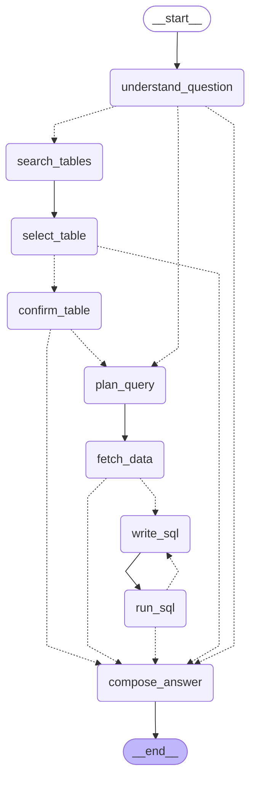

# statline-agent

[](https://statline-agent.streamlit.app)
[](https://github.com/MunzurAtak/statline-agent/actions/workflows/ci.yml)
[](https://github.com/MunzurAtak/statline-agent/pkgs/container/statline-agent)


**An AI data analyst for Dutch open data.** Ask a question in plain language; the agent finds
the right table among ~1,300 datasets of [CBS StatLine](https://opendata.cbs.nl) (Statistics
Netherlands), fetches exactly the data it needs, writes and self-corrects SQL, and answers with
numbers, a chart and a source link. It runs as a chat app with follow-up questions ("En
Amsterdam?"), can ask you to confirm the table it chose, and shows how it got to every answer.

Built with **LangGraph** and **LangChain**, using only free tools and APIs.
**[Try the live demo](https://statline-agent.streamlit.app)** (in Dutch; a few questions per visitor).

### At a glance

<!-- AT_A_GLANCE:START -->
On 12 test questions with `openai/gpt-oss-120b`: the right CBS table **92%** of the time, the correct number in the answer **92%**, and **91%** of the answers fully supported by the data (LLM judge). Median 24 s per question.
<!-- AT_A_GLANCE:END -->
Every number is checked against an independent, LLM-free lookup in the CBS data
([details](#end-to-end-evaluation)). 175+ tests run without network or API key; the app ships
as a Docker image and the evaluation runs on GitHub Actions.

### In plain words

1. **Find the table.** You ask "Hoeveel inwoners heeft Rotterdam?". The agent searches the
   descriptions of ~1,300 CBS tables, like a librarian, and picks the one that fits.
2. **Pick exactly the data.** It decides which figures, regions and years are needed; code
   then translates "Rotterdam" into CBS's own code (`GM0599`), so nothing is guessed.
3. **Calculate.** It writes a database query on that data, runs it, and fixes the query
   itself when it fails.
4. **Answer with proof.** The answer comes with a chart, a link to the source table and a
   "how did I get this?" panel with every step, the filters and the query.

```text
$ statline-agent "Hoe is de bevolking van Rotterdam en Amsterdam sinds 2015 veranderd?"
(output shortened)

[select_table]  03759ned  Bevolking op 1 januari en gemiddeld; geslacht, leeftijd en regio
[plan_query]    RegioS: GM0599, GM0363 · Perioden: 2015JJ00 … 2026JJ00
[run_sql]       24 rijen (poging 1)

In 2015 telde Amsterdam 821.752 inwoners en Rotterdam 623.652. Tegen 2026 steeg de bevolking
van Amsterdam tot 941.927 (+120.175, ≈14,6 %) en die van Rotterdam tot 673.804 (+50.152, ≈8,0 %).

Bron: CBS, Bevolking op 1 januari en gemiddeld (03759ned) - https://dataportal.cbs.nl/detail/CBS/03759ned
```

## How it works

The agent is a LangGraph `StateGraph`. Dashed edges are conditional: the agent can stop early
(no suitable table, data unavailable) and **retries failed SQL with the error message** (up to
3 attempts). This diagram is generated from the code (`scripts/draw_graph.py`).

<!-- GRAPH:START -->

<!-- GRAPH:END -->

| Node | What it does |
|---|---|
| `understand_question` | Reads the conversation: a follow-up ("En Utrecht?") is rewritten as a standalone question and reuses the current table; off-topic questions get a direct answer |
| `search_tables` | Hybrid search over the CBS catalog: vector search + BM25, with LLM query rewriting, fused with Reciprocal Rank Fusion |
| `select_table` | The LLM picks the best table from 8 candidates, seeing each table's measures (an LLM re-ranker) |
| `confirm_table` | Optional human-in-the-loop: the graph pauses (`interrupt`) so the user can confirm or change the table |
| `plan_query` | The LLM chooses measures and names regions/periods in plain language; deterministic code resolves them to CBS codes (`Den Haag` → `GM0518`) |
| `fetch_data` | Downloads only the filtered observations via the OData v4 API and caches them in DuckDB |
| `write_sql` ⇄ `run_sql` | The LLM writes DuckDB SQL; errors (or empty results) go back to the LLM with a hint |
| `compose_answer` | Plain-language answer from the query result only, a declarative chart spec (rendered with Plotly) and the source |

## Design decisions

- **The LLM decides, code executes.** The model never sees full code lists (1,000+ regions) and
  never writes plotting code. It names things; deterministic, tested code maps them to exact
  codes and renders charts. This keeps prompts small (Groq's free tier allows ~8k tokens/minute)
  and behaviour predictable.
- **Generated SQL is untrusted input.** Only a single `SELECT` passes DuckDB's own parser,
  external file/network access is disabled, and every query runs on its own cursor against a
  temporary view, so concurrent users cannot interfere.
- **Structured output everywhere.** Every LLM call returns a Pydantic model. Groq's gpt-oss
  models were unreliable with function calling (`tool_use_failed`), so the agent uses strict
  JSON-schema mode, where the server enforces the schema.
- **Dependency injection via LangGraph's runtime context.** Nodes get the LLM, retriever and
  data store from `runtime.context`, which makes the whole graph testable with a fake LLM.
- **Memory and human-in-the-loop via a checkpointer.** The state of each conversation is saved
  per `thread_id` (SQLite in the app). The confirmation step is a separate node, because
  LangGraph re-runs an interrupted node on resume: the LLM call that chose the table is not
  repeated (or paid for twice).
- **Units are applied in code.** Many CBS figures are published in thousands or millions. The
  data store converts them to plain numbers on load, so neither the SQL nor the answer has to
  do unit arithmetic, which the model got wrong in both directions.
- **Measures keep their context.** CBS measure titles are often only meaningful within their
  group ("Nederland" under "Herkomst"), so the planner sees the full group path and the unit.
- **Ambiguity is handled in code, not left to the model.** "Utrecht" is both a municipality
  and a province. Plain names resolve to the municipality; "provincie Utrecht" to the province,
  and if the model drops the word "provincie", code restores it from the question.

## Retrieval evaluation

Finding the right table is the hardest step. I measured it on 20 realistic questions with known
correct tables ([`evals/retrieval_cases.jsonl`](evals/retrieval_cases.jsonl)):

| Approach | hit@1 | hit@5 | MRR |
|---|---|---|---|
| BM25 only | 0.35 | 0.50 | 0.43 |
| Vector only (multilingual MiniLM) | 0.40 | 0.60 | 0.50 |
| Hybrid (RRF) | 0.45 | 0.55 | 0.51 |
| Hybrid + LLM query rewriting | 0.50 | 0.70 | 0.58 |
| **+ topic-only rewrites and a High Value Dataset boost** | **0.50** | **0.75** | **0.60** |

What I learned along the way:

- **Adding more metadata made search worse.** Indexing each table's measure titles lowered
  hit@5 (0.65 → 0.55): they are often generic ("Totaal", "Mannen") and crowded out the useful
  text in the embedding model's 128-token window. An ablation showed the real problem was on
  the question side: users say *inwoners*, *failliet* and *inflatie*; CBS titles say
  *bevolking*, *faillissementen* and *consumentenprijzen*.
- **LLM query rewriting fixed most of that vocabulary gap.** The prompt's examples deliberately
  do not overlap with the test questions, so the evaluation measures the method, not the prompt.
- **A small boost for CBS's core tables.** The EU designates 47 CBS tables as *High Value
  Datasets* (population, labour, prices…). When one of them is already among the results, it
  gets a small extra rank in the fusion. This helped a little (one question = 0.05 on this
  set), and I found the idea by looking at misses, so take the gain with some caution.
- Most remaining misses rank 6–10; the LLM chooses from the top 8, so the effective recall is
  about 0.85.

## End-to-end evaluation

Retrieval is only one step, so the whole agent is evaluated too: 12 questions, including
follow-up questions, a municipality/province ambiguity and an off-topic question
([`evals/agent_cases.json`](evals/agent_cases.json)).

- **Ground truth without an LLM.** Each case has a *reference query*: a fixed CBS lookup
  (table, measure, region codes) computed live during the evaluation. The agent's own output is
  never used as the truth, and the cases keep working when CBS publishes new figures.
- **Answer accuracy:** does the answer contain the reference number? Dutch number formats
  ("673.804", "56,1%", "1,4 miljoen") are parsed with a small rounding tolerance. The CBS unit
  must be applied: a WOZ value of 409 in "x 1 000 euro" only counts as "€ 409.000".
- **Groundedness:** a second model (LLM-as-judge) checks whether every claim in the answer is
  supported by the query result. It also gets the context the agent had (table, measures with
  units, filters), so a source or a unit is not flagged as a hallucination.
- Also measured: chosen table, SQL attempts, time, LLM calls and tokens per question.

<!-- AGENT_EVAL:START -->
| Case | Table | Answer | Grounded | SQL attempts | Seconds | LLM calls |
|---|---|---|---|---|---|---|
| inwoners-rotterdam | ✅ 03759ned | ✅ | ✅ | 1 | 8.2 | 5 |
| inwoners-gemeente-utrecht | ✅ 03759ned | ✅ | ✅ | 1 | 6.4 | 5 |
| inwoners-provincie-utrecht | ✅ 03759ned | ✅ | ✅ | 1 | 20.6 | 5 |
| vervolgvraag-amsterdam | ✅ 03759ned | ✅ | ✅ | 1 | 48.4 | 9 |
| vervolgvraag-provincie | ✅ 03759ned | ✅ | ✅ | 1 | 43.7 | 9 |
| groei-amsterdam | ✅ 37259ned | ✅ | ✅ | 1 | 29.7 | 5 |
| inwoners-nederland | ❌ 85524NED | ❌ | ❌ | 1 | 30.3 | 5 |
| woz-den-haag | ✅ 85036NED | ✅ | ✅ | 1 | 26.0 | 5 |
| woz-den-haag-groei | ✅ 85036NED | ✅ | ✅ | 1 | 32.4 | 5 |
| woz-rotterdam-2020 | ✅ 85036NED | ✅ | ✅ | 1 | 21.9 | 5 |
| faillissementen-2024 | ✅ 82242NED | ✅ | ✅ | 1 | 20.5 | 5 |
| off-topic | ✅  | ✅ | - | - | 7.7 | 2 |

**Table accuracy:** 92% · **Answer accuracy:** 92% · **Groundedness:** 91% · **Median time:** 23.9 s · **Avg LLM calls:** 5.4
<!-- AGENT_EVAL:END -->

### Model comparison

Every full evaluation run adds or updates its model here. Table and answer accuracy are checked
without an LLM, against the reference values. Groundedness uses the same judge for every model
when a Groq key is set (`gpt-oss-20b`, which means that model judges its own answers), so the
rows are comparable. Local times are measured on a laptop CPU.

<!-- MODEL_COMPARISON:START -->
| Model | Runs on | Table | Answer | Grounded | Median time | Judge |
|---|---|---|---|---|---|---|
| `openai/gpt-oss-120b` | Groq (cloud) | 92% | 92% | 91% | 23.9 s | `openai/gpt-oss-20b` |
<!-- MODEL_COMPARISON:END -->

### What the first run caught

The baseline run ([commit d6ea39b](https://github.com/MunzurAtak/statline-agent/commit/d6ea39b)) scored 100% on table choice, but
only 83% on answers and 64% on groundedness. The causes, and the fixes:

| Symptom | Cause | Fix |
|---|---|---|
| "Nederland has 12.9 million inhabitants" | Table 85496NED has a measure titled *Nederland*: people with a Dutch origin | Measures are shown with their CBS group path (*Bevolking naar herkomst > Herkomstland > Nederland*), a prompt rule says a place name is a region, and the 25-measure shortlist always keeps the best-matching totals. The group path alone did not fix it: on 79 measures, the place name most likely pushed *Totale bevolking* out of the shortlist |
| Amsterdam "shrank 45%" between 2015 and 2025 | Most likely the change in the measure *Totale groei* (yearly growth) was computed instead of the change in the population | Prompt rule: for a change over time, pick the level and let SQL compute the change |
| "The average WOZ value is €409" | The answer did not know the unit (x 1 000 euro); the eval accepted it too | Units are applied in code when the data is loaded (409 in "x 1 000 euro" is stored as 409000 euro) and shown on the chart axis; the eval now requires the unit to be applied. A prompt rule alone was not enough: in a later run the model applied "x 1 000" twice and reported 18 billion inhabitants |
| "periode 2026JJ00" in answers | Raw period codes leaked into the text | Prompt rule: periods and regions as people write them |
| 3 of 4 groundedness failures were false alarms | The judge flagged Dutch number notation, the source mention and a period it could not see | The judge gets the agent's context and explicit rules on notation and units |

## Observability

Tracing with [LangSmith](https://smith.langchain.com) (free Developer plan) is optional: set
`LANGSMITH_TRACING=true` and `LANGSMITH_API_KEY` in `.env`. Every question then becomes a
trace with all nodes, each LLM call (prompt, output, tokens) and the search results. Runs are
tagged by interface (`cli`, `streamlit`, `eval`) and carry the conversation's `thread_id`.

## Tech stack (all free)

| | |
|---|---|
| Agent | LangGraph 1.x, LangChain |
| LLM | Groq free tier (`openai/gpt-oss-120b`; `gpt-oss-20b` for development), experimental local mode with Ollama |
| Retrieval | fastembed (local multilingual embeddings), BM25 with Dutch stemming, LangChain retriever |
| Data | CBS OData v4 API, DuckDB, pandas |
| Charts | Plotly |
| UI | Streamlit chat app (with `AppTest` UI tests) |
| Observability | LangSmith tracing (optional) |
| Quality | pytest (175+ tests, no network or API key needed), mypy `--strict`, ruff, pre-commit, GitHub Actions |
| Delivery | Streamlit Community Cloud, Docker (GitHub Container Registry), scheduled and on-demand workflows |

## Quickstart

Requires [uv](https://docs.astral.sh/uv/) and a free [Groq API key](https://console.groq.com).
The search index is part of the repository, so there is nothing to build first.

```bash
git clone https://github.com/MunzurAtak/statline-agent.git
cd statline-agent
cp .env.example .env            # add your GROQ_API_KEY
uv sync
uv run streamlit run streamlit_app.py           # chat app on http://localhost:8501
```

Or with Docker, without installing Python:

```bash
docker run -p 8501:8501 -e GROQ_API_KEY=... ghcr.io/munzuratak/statline-agent:latest
```

Or use the command line (leave out the question for a chat with follow-ups):

```bash
uv run statline-agent "Wat is de gemiddelde WOZ-waarde in Den Haag?" --open
```

### Lighter models: more room on the free tier, or fully local

Groq's free tier has a daily token limit per model (about 2–3 full evaluations with
`gpt-oss-120b`). During development, a smaller Groq model has its own limit and is fast:

```bash
LLM_MODEL=openai/gpt-oss-20b
```

The agent can also run fully offline with [Ollama](https://ollama.com) (`LLM_PROVIDER=ollama`,
default model `qwen3.5:4b`, fits in 16 GB RAM without a GPU). This is experimental: in a first
test the 4B model went wrong at almost every step (table choice, measure codes, SQL), so a
five-step agent clearly needs a larger model. The app checks at startup that Ollama is running
and the model is downloaded (`ollama pull qwen3.5:4b`).

Evaluations of other models are written to `evals/results/agent-<model>.json`; they appear in
the model comparison but never replace the published per-case results.

### Checks and evaluations

```bash
uv run pytest
uv run mypy
uv run python evals/run_retrieval_eval.py
uv run python evals/run_agent_eval.py
```

## Deployment and automation

| What | How |
|---|---|
| Live demo | [Streamlit Community Cloud](https://streamlit.io/cloud) (free), deployed from `main`; the API key is a Streamlit secret and `DEMO_MAX_QUESTIONS` limits questions per visitor, so the free daily token limit is shared fairly |
| Docker image | Multi-stage build with uv; the embedding model is baked in. Built and smoke-tested on every pull request, published to GitHub Container Registry from `main` and version tags ([`docker.yml`](.github/workflows/docker.yml)) |
| Checks | Lint, formatting, type check and tests on every push ([`ci.yml`](.github/workflows/ci.yml)) |
| Search index | Rebuilt monthly from the live CBS catalog and committed when it changed ([`refresh-catalog.yml`](.github/workflows/refresh-catalog.yml)); stored compactly (float16 vectors, ~1 MB) |
| Evaluation | On demand from the Actions tab, for either model, optionally committing the results ([`eval.yml`](.github/workflows/eval.yml)) |

## Project structure

```text
src/statline_agent/
├── agent/        # LangGraph state, nodes, graph and runtime context
├── catalog/      # catalog index, hybrid retriever, query rewriting
├── cbs/          # typed CBS OData client and DuckDB cache (with safe SQL execution)
├── ui/           # Streamlit chat app (rendering) and testable helpers
├── charts.py     # chart spec -> Plotly figure
├── evaluation.py # retrieval metrics (hit@k, MRR)
├── agent_eval.py # end-to-end evaluation: reference queries, answer checks, LLM judge
├── observability.py  # optional LangSmith tracing
└── cli.py        # streaming command line interface
streamlit_app.py  # entry point of the chat app
data/             # search index over the CBS catalog (refreshed monthly)
evals/            # test questions, evaluation runners and published results
scripts/          # index builder, search comparison, diagram generator
tests/            # unit and graph tests with recorded CBS responses and a fake LLM
Dockerfile, compose.yaml   # container image (optionally with a local Ollama)
.github/workflows/         # CI, Docker, catalog refresh, evaluation
```

## Roadmap

- [x] Typed CBS client, DuckDB cache, CI
- [x] Hybrid catalog search with evaluation
- [x] Agent: table selection, query planning, self-correcting SQL, answer with chart
- [x] Conversation memory, follow-up questions and human-in-the-loop (checkpointer, interrupts)
- [x] Streamlit chat app with live progress, charts and explanations
- [x] End-to-end evaluation and tracing with LangSmith
- [x] Public demo, Docker image, scheduled index refresh and evaluation on GitHub Actions

## License

MIT. Data: © CBS, [CC BY 4.0](https://creativecommons.org/licenses/by/4.0/).
