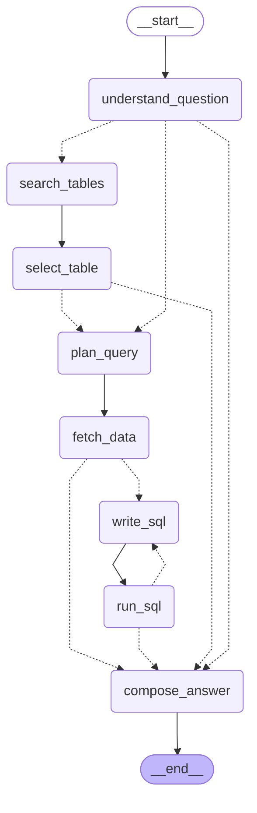

# statline-agent

[](https://github.com/MunzurAtak/statline-agent/actions/workflows/ci.yml)


**An AI data analyst for Dutch open data.** Ask a question in plain language; the agent finds
the right table among ~1,300 datasets of [CBS StatLine](https://opendata.cbs.nl) (Statistics
Netherlands), fetches exactly the data it needs, writes and self-corrects SQL, and answers with
numbers, a chart and a source link.

Built with **LangGraph** and **LangChain**, using only free tools and APIs.

```text
$ statline-agent "Hoe is de bevolking van Rotterdam en Amsterdam sinds 2015 veranderd?"
(output shortened)

[select_table]  03759ned  Bevolking op 1 januari en gemiddeld; geslacht, leeftijd en regio
[plan_query]    RegioS: GM0599, GM0363 · Perioden: 2015JJ00 … 2026JJ00
[run_sql]       24 rijen (poging 1)

In 2015 telde Amsterdam 821.752 inwoners en Rotterdam 623.652. Tegen 2026 steeg de bevolking
van Amsterdam tot 941.927 (+120.175, ≈14,6 %) en die van Rotterdam tot 673.804 (+50.152, ≈8,0 %).

Bron: CBS, Bevolking op 1 januari en gemiddeld (03759ned) - https://dataportal.cbs.nl/detail/CBS/03759ned
```

## How it works

The agent is a LangGraph `StateGraph`. Dashed edges are conditional: the agent can stop early
(no suitable table, data unavailable) and **retries failed SQL with the error message** (up to
3 attempts). This diagram is generated from the code (`scripts/draw_graph.py`).

<!-- GRAPH:START -->

<!-- GRAPH:END -->

| Node | What it does |
|---|---|
| `search_tables` | Hybrid search over the CBS catalog: vector search + BM25, with LLM query rewriting, fused with Reciprocal Rank Fusion |
| `select_table` | The LLM picks the best table from 8 candidates, seeing each table's measures (an LLM re-ranker) |
| `plan_query` | The LLM chooses measures and names regions/periods in plain language; deterministic code resolves them to CBS codes (`Den Haag` → `GM0518`) |
| `fetch_data` | Downloads only the filtered observations via the OData v4 API and caches them in DuckDB |
| `write_sql` ⇄ `run_sql` | The LLM writes DuckDB SQL; errors (or empty results) go back to the LLM with a hint |
| `compose_answer` | Plain-language answer from the query result only, a declarative chart spec (rendered with Plotly) and the source |

## Design decisions

- **The LLM decides, code executes.** The model never sees full code lists (1,000+ regions) and
  never writes plotting code. It names things; deterministic, tested code maps them to exact
  codes and renders charts. This keeps prompts small (Groq's free tier allows ~8k tokens/minute)
  and behaviour predictable.
- **Generated SQL is untrusted input.** Only a single `SELECT` passes DuckDB's own parser,
  external file/network access is disabled, and every query runs on its own cursor against a
  temporary view, so concurrent users cannot interfere.
- **Structured output everywhere.** Every LLM call returns a Pydantic model. Groq's gpt-oss
  models were unreliable with function calling (`tool_use_failed`), so the agent uses strict
  JSON-schema mode, where the server enforces the schema.
- **Dependency injection via LangGraph's runtime context.** Nodes get the LLM, retriever and
  data store from `runtime.context`, which makes the whole graph testable with a fake LLM.

## Retrieval evaluation

Finding the right table is the hardest step. I measured it on 20 realistic questions with known
correct tables ([`evals/retrieval_cases.jsonl`](evals/retrieval_cases.jsonl)):

| Approach | hit@1 | hit@5 | MRR |
|---|---|---|---|
| BM25 only | 0.35 | 0.50 | 0.43 |
| Vector only (multilingual MiniLM) | 0.40 | 0.60 | 0.50 |
| Hybrid (RRF) | 0.45 | 0.55 | 0.51 |
| **Hybrid + LLM query rewriting** | **0.50** | **0.70** | **0.58** |

What I learned along the way:

- **Adding more metadata made search worse.** Indexing each table's measure titles lowered
  hit@5 (0.65 → 0.55): they are often generic ("Totaal", "Mannen") and crowded out the useful
  text in the embedding model's 128-token window. An ablation showed the real problem was on
  the question side: users say *inwoners*, *failliet* and *inflatie*; CBS titles say
  *bevolking*, *faillissementen* and *consumentenprijzen*.
- **LLM query rewriting fixed most of that vocabulary gap.** The prompt's examples deliberately
  do not overlap with the test questions, so the evaluation measures the method, not the prompt.
- Most remaining misses rank 6–10; the LLM chooses from the top 8, so the effective recall is
  about 0.85.

## Tech stack (all free)

| | |
|---|---|
| Agent | LangGraph 1.x, LangChain |
| LLM | Groq free tier (`openai/gpt-oss-120b`) or local Ollama |
| Retrieval | fastembed (local multilingual embeddings), BM25 with Dutch stemming, LangChain retriever |
| Data | CBS OData v4 API, DuckDB, pandas |
| Charts | Plotly |
| Quality | pytest (90+ tests, no network or API key needed), mypy `--strict`, ruff, pre-commit, GitHub Actions |

## Quickstart

Requires [uv](https://docs.astral.sh/uv/) and a free [Groq API key](https://console.groq.com).

```bash
git clone https://github.com/MunzurAtak/statline-agent.git
cd statline-agent
cp .env.example .env            # add your GROQ_API_KEY
uv sync
uv run python scripts/build_catalog_index.py    # ~2-5 min the first time
uv run statline-agent "Wat is de gemiddelde WOZ-waarde in Den Haag?" --open
```

Run the checks and the retrieval evaluation:

```bash
uv run pytest
uv run mypy
uv run python evals/run_retrieval_eval.py
```

## Project structure

```text
src/statline_agent/
├── agent/        # LangGraph state, nodes, graph and runtime context
├── catalog/      # catalog index, hybrid retriever, query rewriting
├── cbs/          # typed CBS OData client and DuckDB cache (with safe SQL execution)
├── charts.py     # chart spec -> Plotly figure
├── evaluation.py # retrieval metrics (hit@k, MRR)
└── cli.py        # streaming command line interface
evals/            # test questions and evaluation runner
scripts/          # index builder, search comparison, diagram generator
tests/            # unit and graph tests with recorded CBS responses and a fake LLM
```

## Roadmap

- [x] Typed CBS client, DuckDB cache, CI
- [x] Hybrid catalog search with evaluation
- [x] Agent: table selection, query planning, self-correcting SQL, answer with chart
- [ ] Human-in-the-loop table confirmation and follow-up questions (checkpointer)
- [ ] FastAPI backend with streaming and a Streamlit UI
- [ ] End-to-end evaluation and tracing with LangSmith
- [ ] Docker image and a public demo

## License

MIT. Data: © CBS, [CC BY 4.0](https://creativecommons.org/licenses/by/4.0/).
